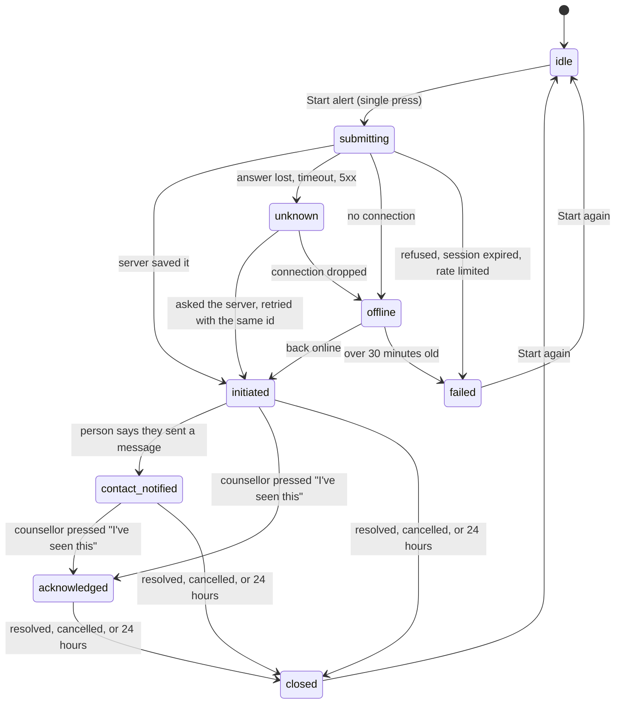

# Instant EMS: how it really works

**4Life cannot send an ambulance.** It has no connection to the National Ambulance Service, 112, or any dispatch system. Only a phone call from the person's own phone reaches emergency services. No screen, status or record in the app may suggest otherwise.

What the app does: puts 112 and 193 one tap away, saves an alert that a linked counsellor can see, and prepares a message with the person's location for them to send from their own phone.

## What exists

| Capability | Status | Where | Provider and evidence |
|---|---|---|---|
| Start an alert | Implemented, tested locally, not deployed | `EmergencyPanel.tsx`, `incident.ts`, `emergency_open_incident` | Automated tests only |
| Current location | Implemented, tested in Chrome | `getPosition` in `ems.ts` | Browser geolocation; not yet tried on a real phone |
| Message a support person | Implemented: opens the phone's own app | `smsHref`, `whatsappHref` | The person presses send. Delivery can't be seen |
| In-app alert to a linked counsellor | Implemented, tested locally, not deployed | `sos_events`, `escalations`, `emergency_notifications` | No push: seen when the counsellor next has 4Life open |
| Counsellor acknowledgement | Implemented, tested at database and client level | `IncidentAck.tsx`, `emergency_acknowledge` | The button itself has not been run in a browser |
| Status, history, refresh recovery | Implemented, tested locally | `emergency_incidents`, `emergency_incident_events` | Automated tests only |
| SMS or email sent by the server | **Missing, blocked** | None | Needs a provider account and recorded contact consent |
| Escalation when nobody responds | **Missing** | None | Needs a server-sent channel first. Today the app tells the person no one has confirmed |
| Emergency services integration | **Missing, blocked** | None | See "If a real integration becomes possible" |

## The workflow



`idle`, `submitting`, `unknown`, `offline` and `failed` exist only on the phone. The rest are in the database, which is the authority. The app's table (`TRANSITIONS` in `src/lib/incident.ts`) and the database trigger (`emergency_guard_status`) must match; `npm run test:emergency` fails if they drift apart.

There is deliberately no `EMS_SUBMITTED` or `DISPATCHED` state. Nothing can reach them.

| Word | Means | Does not mean |
|---|---|---|
| Saved (`initiated`) | The server stored the incident | Any person has seen it |
| Recorded (counsellor) | The alert is waiting in the counsellor's app | They saw it |
| Opened | The phone's messaging or phone app was opened | Sent, or a call connected |
| Reported sent (`contact_notified`) | The person told us they pressed send | Delivered or read |
| Acknowledged | A counsellor pressed "I've seen this" | An ambulance or help is coming |
| Unknown | The answer was lost, so it may or may not be saved | Failed |

## Failure behaviour

The call buttons and message links are ordinary phone links, so they work in every state below.

| What goes wrong | What the person sees | What the app does |
|---|---|---|
| Answer lost after saving | "Not sure yet if your alert was saved" | Asks the server by request id, retries with the same id: no duplicate |
| Server or database down | Same | Retries at 2, 5, 10, 20, then every 30 seconds |
| Offline | "Your alert is not saved yet" | Sends when back online. Dropped after 30 minutes, and says so |
| Page refreshed mid-request | Status comes back | The request id is in `localStorage`; the server decides |
| Page refreshed with an alert open | Banner and status come back | Looks for the location again, so messages still include it |
| Session expired | "Not saved. Sign in again. No one was told." | No retry |
| Six alerts in an hour | "Not saved. Too many alerts." | No retry |
| Location denied, slow or unavailable | Explained, with "Try again" and "Write a landmark" | Never holds up the alert. The message says there is no exact location |
| Location or action can't reach the server | "Last confirmed at…" | Kept in memory and retried. Lost if the page is closed first |
| Cancel or close can't reach the server | "Your alert is still open" | Stays open; press again |
| Double press, two phones or tabs | One alert | Advisory lock, unique indexes |
| Alert left open | Closes after 24 hours | Marked `expired`, and doesn't block a new one |

## Privacy

- **Coordinates** live only in `sos_events`, and only with `share_location_in_crisis` on. Off: the app doesn't send them, and the database ignores any it receives. They are not stored on the incident, in the history, in logs or in URLs.
- **Counsellor location requests** are answered only while the person's own alert is open.
- **OpenStreetMap services** receive the position when Instant EMS looks up places and routes. The screen says so. Set your own servers with `VITE_OVERPASS_URL`, `VITE_NOMINATIM_URL` and `VITE_OSRM_URL` for a launch.
- **Support people's** names and numbers stay in `support_contacts`. Incidents hold a reference.
- **Access:** a person sees their own incidents. A linked counsellor sees status and their own alert row, not which support people were contacted. All writes go through `SECURITY DEFINER` functions that use `auth.uid()`; no user id is accepted from the app.
- **Retention:** incidents 90 days after closing (`purge_expired_incidents`), coordinates 30 days (`purge_expired_locations`). Both need scheduling; see below. Included in `export_my_data`.

## Deploying

No new secrets or environment variables. The service-role key is not used.

1. Run the tests: `npm run lint && npm run test:unit && npm run test:emergency && npm run test:emergency:e2e`. Use Node 22 as `package.json` requires.
2. Apply the migration to a staging project: `supabase db push`. It only adds objects, plus one nullable column on `sos_events`, and replaces two functions (`sos_notify_therapists`, `export_my_data`).
3. Schedule the clean-ups (needs the pg_cron extension):
   ```sql
   select cron.schedule('purge-old-incidents', '20 3 * * *', $$select public.purge_expired_incidents()$$);
   select cron.schedule('purge-old-locations', '15 3 * * *', $$select public.purge_expired_locations()$$);
   ```
4. Deploy a preview, and go through "Manual checks".
5. Deploy to production. Only then does the new app call the new functions: **apply the migration first**, or new alerts show "not sure" and then fail.

**Rollback:** redeploy the previous app version. The new tables can stay; the old app doesn't use them. Don't drop them without exporting first, because they hold crisis records.

### Monitoring

Nothing is alerting yet. Before launch, add to the Supabase dashboard or a daily check:

```sql
-- Alerts no counsellor acknowledged within 15 minutes
select count(*) from emergency_incidents i
 where status in ('initiated', 'contact_notified') and created_at < now() - interval '15 minutes'
   and exists (select 1 from emergency_notifications n where n.incident_id = i.id and n.channel = 'counsellor_in_app');
-- Outcomes over the last 7 days
select status, count(*) from emergency_incidents where created_at > now() - interval '7 days' group by 1;
```

Client-side failures (`unknown`, `failed`) aren't reported anywhere yet, because a phone that can't reach the server can't report it.

### Manual checks (real phones, Android and iPhone)

Use a test account and a support-person number you own. **Don't dial 112 or 193 to test.** Tapping should bring up the dialler with the number filled in: stop there.

- [ ] Start an alert. Check the row in `emergency_incidents` matches the screen.
- [ ] Location prompt: allow, deny, and with location services off.
- [ ] "Text" opens the messaging app with the map link. Send it to your own test number and open the link.
- [ ] WhatsApp opens with the message.
- [ ] As a test counsellor, open the Safety map and press "I've seen this". The client's phone shows it within about 15 seconds.
- [ ] Refresh during an alert. Airplane mode during an alert.
- [ ] Screen reader (TalkBack, VoiceOver) reads the status changes.

## If a real integration becomes possible

Nothing was built for this, on purpose. A dispatch integration needs, from the organisation itself: written authorisation, official API documentation, a test environment, confirmed coverage, and a named escalation contact. Add a state only for what its documented response proves, and test only in its sandbox.

For server-sent SMS or email: a provider account (none is configured; Resend appears only as "resend confirmation email" wording), a record that each support person agreed to receive alerts (`support_contacts` has no such field), signed delivery webhooks with replay protection, and the delivery states the provider really documents.

## Decisions for the owner

- **Account deletion is blocked for anyone with counsellor escalations.** `escalations` is append-only, so the cascade from deleting a profile raises an error. This was already the case; pressing SOS with a linked counsellor creates such rows. Whether a crisis record should outlive the account is a legal and clinical decision (it needs a Ghana Data Protection Act review), so it was left unchanged.
- **Hotline numbers come from a published list (TherapyRoute), and nobody has recorded calling them.** The app used to say "checked"; it now names the source. Have someone confirm each one with the provider.
- **The name "Instant EMS"** suggests a dispatch service. Consider "Emergency help".
